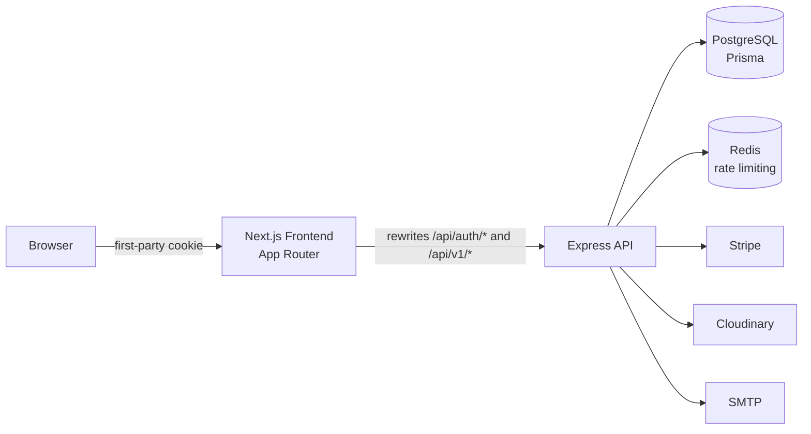
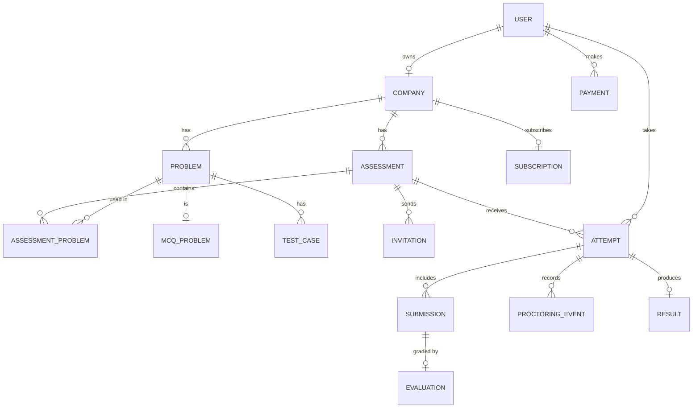
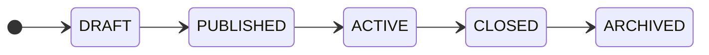
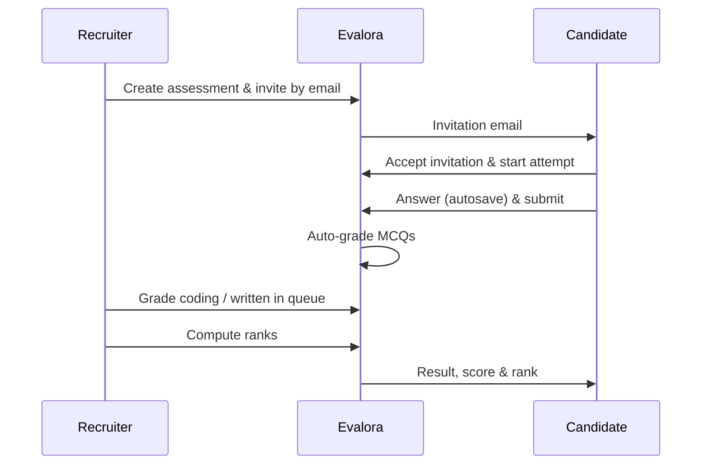

<div align="center">

<!-- Replace with your logo: place it at public/logo.png -->


# Evalora

### The developer assessment platform for modern hiring teams

Build coding assessments, invite candidates, and review scores, ranks and proctoring signals — all in one place.

<br />

[](https://evalora-client.vercel.app)
[](https://evalora-server.vercel.app)


[**Live Demo**](https://evalora-client.vercel.app) ·
[**Demo Accounts**](#-demo-accounts) ·
[**Features**](#-features) ·
[**Architecture**](#-architecture) ·
[**Getting Started**](#-getting-started)

</div>

---

## 📑 Table of Contents

- [Overview](#-overview)
- [Demo Accounts](#-demo-accounts)
- [Screenshots](#-screenshots)
- [Features](#-features)
- [Roles & Permissions](#-roles--permissions)
- [Tech Stack](#-tech-stack)
- [Architecture](#-architecture)
- [Data Model](#-data-model)
- [Assessment Lifecycle](#-assessment-lifecycle)
- [Project Structure](#-project-structure)
- [Getting Started](#-getting-started)
- [Environment Variables](#-environment-variables)
- [Deployment](#-deployment)
- [Security & Privacy](#-security--privacy)
- [Known Limitations](#-known-limitations)
- [Roadmap](#-roadmap)
- [Contributing](#-contributing)
- [License](#-license)
- [Contact](#-contact)

---

## ✨ Overview

**Evalora** is a full-featured assessment platform that takes recruiters from *"create a test"* to *"hire with confidence"*.

Recruiters build assessments from a reusable problem bank (MCQ, coding and written questions), invite candidates by email, and review results through a grading queue, a live leaderboard and a proctoring timeline. Candidates get a focused, timed exam experience with autosave and a clear view of their results.

| | |
|---|---|
| 🎯 **Built for** | Recruiters, hiring managers, engineering teams, candidates |
| 🧩 **Question types** | MCQ (single & multiple choice), coding, written |
| 🛡️ **Integrity** | Proctoring signals recorded for a human reviewer |
| 🏢 **Tenancy** | Multi-tenant — every query is scoped to the company |
| 🚀 **Deployed on** | Vercel (frontend + API) |

---

## 🔑 Demo Accounts

> Password for **all** demo accounts: `Demo@12345`

| Role | Email | What you'll see |
|---|---|---|
| 👔 Recruiter | `recruiter@demo.com` | Assessment builder, leaderboard, proctoring timeline, grading queue |
| ✅ Candidate (finished attempt) | `candidate1@demo.com` | Completed result with score, rank and status |
| ✉️ Candidate (pending invitation) | `candidate2@demo.com` | Accept an invitation and take the assessment |

**Suggested tour**

1. Sign in as the **recruiter** and explore assessments, the leaderboard, the proctoring timeline and the grading queue.
2. Sign in as **`candidate2@demo.com`**, accept the invitation and take the assessment.
3. Return to the recruiter account to grade the submission and compute ranks.

---

## 🖼️ Screenshots

<!-- Add screenshots to /docs/screenshots and update the paths below -->

| Recruiter dashboard | Assessment builder |
|---|---|
|  |  |

| Timed exam runner | Leaderboard & results |
|---|---|
|  |  |

---

## 🚀 Features

### 🧪 Assessments
- Problem bank with **MCQ, coding and written** questions
- Marks, time limits, attempt limits, versioning and optional start/end windows
- Timed attempts with **autosave**, optional question shuffling and forward-only review
- Email invitations — candidates accept and start from their dashboard

### 📊 Grading & Results
- MCQs graded **automatically**
- Coding and written answers graded by reviewers through a **grading queue**
- Results, ranks and a **live leaderboard** with one-click rank computation

### 🛡️ Proctoring
- Signals recorded for a human reviewer: **tab switches, window focus, full-screen exits, copy and paste**
- Per-attempt **proctoring timeline** for recruiters

### 💳 Platform
- Plans — **Free, Pro, Enterprise** — with usage limits
- **Stripe** checkout (one-time payment, 30 days)
- **Two-factor authentication**, email OTP verification, Google and GitHub sign-in
- Candidate controls: profile visibility to recruiters, data export, account deletion
- Admin tools: users, companies, payments, audit logs, blog, contact messages
- Public site: home, pricing, blog (Markdown, RSS, sitemap), contact, legal pages

---

## 👥 Roles & Permissions

| Capability | Candidate | Recruiter | Admin |
|---|:---:|:---:|:---:|
| Accept invitations & take assessments | ✅ | — | — |
| View own results, rank and status | ✅ | — | — |
| Manage profile visibility, export / delete data | ✅ | — | — |
| Build problems & assessments | — | ✅ | — |
| Invite candidates | — | ✅ | — |
| Grade submissions, view proctoring timeline | — | ✅ | — |
| Leaderboard & rank computation | — | ✅ | — |
| Manage plans & checkout | — | ✅ | — |
| Manage users, companies, payments | — | — | ✅ |
| Audit logs, blog, contact messages | — | — | ✅ |

---

## 🧰 Tech Stack

| Layer | Technologies |
|---|---|
| **Frontend** | Next.js 16 (App Router) · React 19 · TypeScript 5 · Tailwind CSS 4 · shadcn/ui |
| **Data & Forms** | TanStack Query · TanStack Form · Zod |
| **Auth** | Better Auth (sessions, 2FA, OTP, OAuth) |
| **Backend** *(separate repo)* | Express 5 · Prisma 7 · PostgreSQL · Redis (rate limiting) |
| **Services** | Stripe · Cloudinary · SMTP |
| **Hosting** | Vercel |

---

## 🏗️ Architecture



**Key decisions**

- **Two projects** — this frontend and an Express API ([evalora-server.vercel.app](https://evalora-server.vercel.app)). The frontend proxies `/api/auth/*` and `/api/v1/*` to the API via Next.js rewrites, so the session cookie stays **first-party**.
- **Multi-tenant** — every recruiter query is scoped to the company; other companies' data returns `404`.
- **Idempotency keys** protect invitations, attempt start/submit and checkout from duplicate requests.
- **Coding answers are never executed** — reviewers read the code next to the sample test cases.

---

## 🗄️ Data Model

The database is PostgreSQL managed through Prisma. A simplified view of the core entities:



| Domain | Models |
|---|---|
| **Identity** | `User`, `Account`, `Session`, `Verification`, `TwoFactor`, `UserConsent`, `CandidateProfile` |
| **Tenancy** | `Company` |
| **Content** | `Problem`, `McqProblem`, `McqOption`, `TestCase`, `Assessment`, `AssessmentProblem` |
| **Candidate flow** | `AssessmentInvitation`, `AssessmentAttempt`, `Submission`, `SubmissionAnswer`, `SubmissionEvaluation`, `TestCaseResult`, `Result`, `ProctoringEvent` |
| **Billing** | `Subscription`, `Payment`, `PaymentWebhookEvent` |
| **Platform** | `Notification`, `AuditLog`, `IdempotencyKey`, `BlogPost`, `BlogCategory`, `BlogTag`, `ContactMessage` |

**Design notes**

- Soft deletes via `deletedAt` on users, companies, problems and assessments.
- Assessments are **versioned** (`version`, `isLatestVersion`, `parentAssessmentId`); archive instead of hard-deleting once attempts exist.
- One submission per problem per attempt; one result per attempt.
- Credentials and sessions are owned by **Better Auth** — no password fields on `User`.

---

## 🔄 Assessment Lifecycle





---

## 📁 Project Structure

```
src/
├── app/                  # App Router routes
│   ├── (public)/         # Marketing site + auth flows
│   ├── (dashboard)/      # Role-scoped workspaces (recruiter / candidate / admin)
│   ├── exam/             # Timed attempt runner
│   └── billing/          # Stripe return URLs
├── components/
│   ├── module/           # Feature modules (assessment, attempt, result, …)
│   ├── dashboard/        # Sidebar, navbar, shell
│   └── ui/               # shadcn/ui primitives
├── hooks/                # TanStack Query hooks per domain
├── lib/                  # API client, toast, utils
└── types/                # Zod schemas + inferred types
```

---

## 🏁 Getting Started

### Prerequisites

- **Node.js** 20+
- **pnpm** 9+
- A running instance of the **Evalora API** (separate repo) with PostgreSQL

### 1. Clone & install

```bash
git clone <your-repo-url> evalora-client
cd evalora-client
pnpm install
```

### 2. Configure environment

```bash
cp .env.example .env.local
```

### 3. Start the dev server

```bash
pnpm dev
```

Open [http://localhost:3000](http://localhost:3000).

### Backend (separate repo)

Set `DATABASE_URL`, `BETTER_AUTH_SECRET`, `BETTER_AUTH_URL=http://localhost:3000`, `CLIENT_URL=http://localhost:3000`, plus Stripe, Cloudinary, SMTP and Redis variables, then:

```bash
pnpm migrate
pnpm seed
pnpm dev
```

> `pnpm seed` creates the demo accounts listed [above](#-demo-accounts).

---

## 🔐 Environment Variables

### Frontend

| Variable | Description | Example |
|---|---|---|
| `NEXT_PUBLIC_API_BASE_URL` | API path used by the client | `/api/v1` |
| `NEXT_PUBLIC_AUTH_BASE_URL` | Auth base URL | `http://localhost:3000` |
| `NEXT_PUBLIC_SITE_URL` | Public site URL | `http://localhost:3000` |
| `BACKEND_URL` | API origin used by Next.js rewrites | `http://localhost:5000` |
| `INTERNAL_API_SECRET` | Shared secret for internal calls | `<random string>` |

### Backend

| Variable | Description |
|---|---|
| `DATABASE_URL` | PostgreSQL connection string |
| `BETTER_AUTH_SECRET` | Auth signing secret |
| `BETTER_AUTH_URL` | Frontend URL (e.g. `http://localhost:3000`) |
| `CLIENT_URL` | Allowed client origin |
| Stripe · Cloudinary · SMTP · Redis | Service credentials |

> ⚠️ Never commit `.env` files or real secrets.

---

## ☁️ Deployment

Both projects are deployed on **Vercel**.

| Project | URL |
|---|---|
| Frontend | https://evalora-client.vercel.app |
| API | https://evalora-server.vercel.app |

1. Import each repository into Vercel.
2. Add the environment variables above to each project.
3. Point `BACKEND_URL` (frontend) at the deployed API.
4. Run `pnpm migrate` against the production database.

---

## 🛡️ Security & Privacy

- **Two-factor authentication** and email OTP verification
- **First-party session cookies** through proxied rewrites
- **Redis-backed rate limiting** on the API
- **Idempotency keys** to prevent duplicate invitations, attempts and payments
- **Tenant isolation** — cross-company access returns `404`
- **Audit logs** for security-relevant and administrative actions
- **Candidate data controls** — visibility, export and account deletion
- **No code execution** — candidate code is reviewed, never run

---

## ⚠️ Known Limitations

- Paid plans are **one-time payments for 30 days**; there is no automatic renewal.
- Emails are sent through SMTP, so **volume is limited**.
- Uploads are limited to **4 MB** (serverless request limit).

---

## 🗺️ Roadmap

- [ ] Recurring subscriptions with automatic renewal
- [ ] Sandboxed code execution with automated test-case grading
- [ ] Higher-volume transactional email provider
- [ ] Camera / microphone proctoring signals
- [ ] Larger file uploads via direct-to-storage

---

## 🤝 Contributing

Contributions are welcome!

1. Fork the project
2. Create a branch — `git checkout -b feature/amazing-feature`
3. Commit your changes — `git commit -m "Add amazing feature"`
4. Push the branch — `git push origin feature/amazing-feature`
5. Open a Pull Request

---

## 📄 License

Distributed under the **MIT License**. See [`LICENSE`](LICENSE) for details.

---

## 📬 Contact

**Your Name** — [@your-handle](https://www.linkedin.com/in/your-profile/) · [you@example.com](mailto:you@example.com)

Project: [Evalora](https://evalora-client.vercel.app)

<div align="center">

<br />

Built with ❤️ using Next.js & React

⭐ If you find Evalora useful, consider giving it a star!

</div>